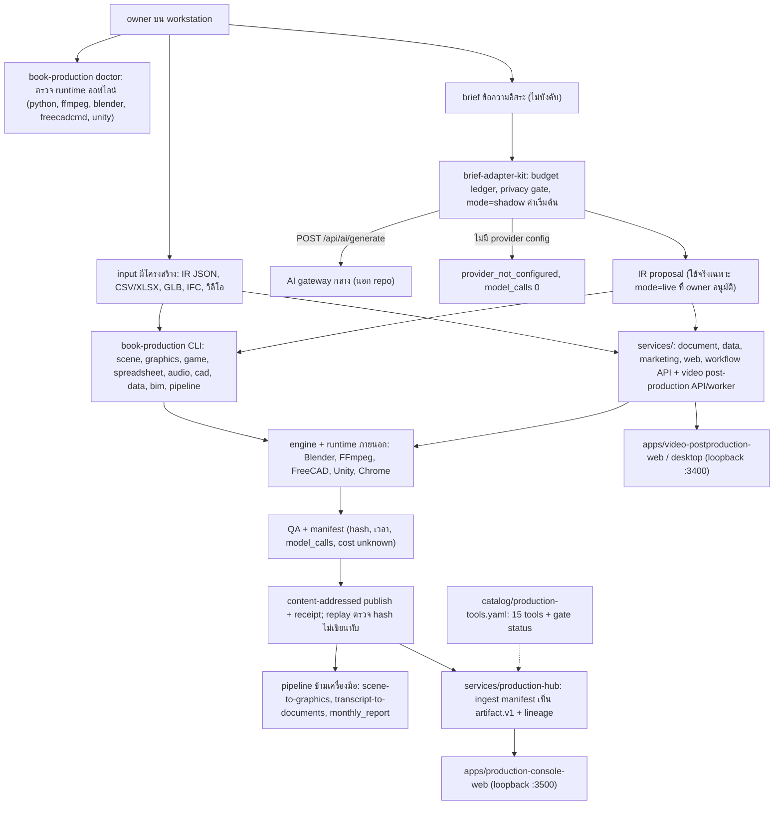
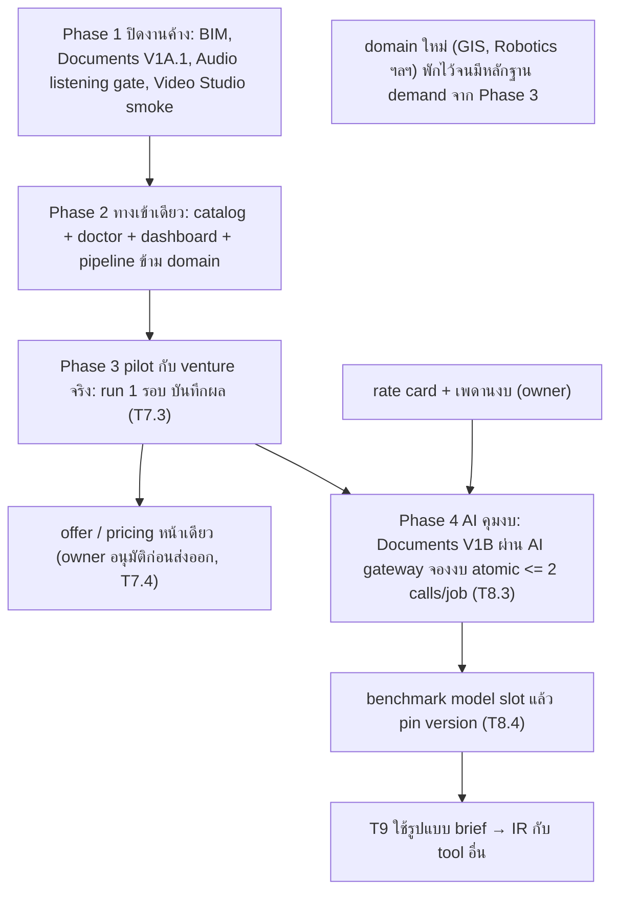

# 01 — Business process (As-Is / To-Be)

content-production (Book Production Platform) คือชุดเครื่องมือผลิตงานแบบ local-first ของ owner ที่แปลง input มีโครงสร้าง (JSON IR, CSV/XLSX, brief) เป็นไฟล์งานจริงด้วย engine แบบ deterministic: ฉาก 3D, graphics, spreadsheet, SQL/data, CAD, BIM, audio, เกม Unity, เอกสาร, เว็บ, marketing, workflow และ video post-production โดยใช้โมเดลเฉพาะขั้น brief adapter ผ่าน AI gateway กลาง ไม่มี hosted deployment

Last reviewed: 2026-11-28 · commit `e8d7aec`

## As-Is (จากโค้ดวันนี้)

ภาพนี้สรุประดับแพลตฟอร์ม (repo ใหญ่: อ่าน entry points, README, PRODUCT.md และ docs เป็นหลัก ไม่ได้ไล่ทุกโมดูล)

Sources: `src/book_production_platform/cli.py`, `src/book_production_platform/doctor.py`, `src/book_production_platform/brief_adapter_kit/config.py` (`mode = shadow`), `services/production-hub/README.md`, `services/production-pipelines/`, `services/video-postproduction/README.md`, `apps/production-console-web/README.md`, `catalog/production-tools.yaml`, `README.md`, `PRODUCT.md`, `.github/workflows/ci.yml`

ข้อเท็จจริงสำคัญ:

- catalog มี 15 tools: accepted 11, pilot-ready 1 (documents), needs-human-gate 3 (video-studio, audio-batch-v1a ซึ่งอยู่ใน `content-audio-mastering-cli`, audio-master-v1a)
- CI ไม่มี Blender, FreeCAD, Unity: test ที่ต้องใช้ runtime จริงจะ skip; `video-postproduction` และ `video-postproduction-api` ยังรันโดยไม่มี mypy (`PRODUCT.md` §Limits)
- ไม่มีผลบันทึก live shadow-run กับ gateway จริงใน repo (`PRODUCT.md` §AI)
- spec ของ Production Hub อ้างถึง Solo Empire `docs/superpowers/specs/2026-09-30-production-hub-and-tool-coverage-design.md` ซึ่ง repo นั้น archive แล้ว ตำแหน่งปัจจุบัน [ต้องยืนยัน]

## To-Be (docs/superpowers/plans/2026-09-26-production-tools-roadmap.md, status: proposed)

Sources: `docs/superpowers/plans/2026-09-26-production-tools-roadmap.md` (Phase 1–4, §สถานะการปฏิบัติ, §พักไว้ก่อน), `docs/superpowers/specs/2026-09-22-logic-first-production-platform-design.md` (status: proposed-written-design), `docs/UPGRADE-PLAN.md` §Backlog

## Gap

| ID | As-Is → To-Be | Status | Owner | Evidence |
|---|---|---|---|---|
| G1 | BIM Quantity Takeoff V1A ยังไม่ทำ → 20/20 เคส, replay ตรง hash | done | claude | roadmap §สถานะการปฏิบัติ T1; `catalog/production-tools.yaml` |
| G2 | Documents V1A.1 ยังไม่ทนทาน → ledger กันงานซ้ำ, ไทยไม่หายเงียบ | done | claude | roadmap T2 (root commit `1dcf44b9`) |
| G3 | Documents ค้าง visual golden → ผ่าน human/visual gate | todo | owner | roadmap T2 "คงเหลือ"; catalog `documents-v1a` = pilot-ready |
| G4 | Video Studio ยังไม่ smoke บนเครื่องใหม่และคลิปไทย 30–60 นาที → มีตัวเลขยืนยัน | todo | owner | roadmap T4.1, T4.2; catalog `video-studio` = needs-human-gate |
| G5 | หลายทางเข้า → catalog + doctor + dashboard ทางเข้าเดียว | done | claude | roadmap T5 (root commit `d255bccc`); `catalog/production-tools.yaml`; `src/book_production_platform/doctor.py` |
| G6 | tool แยกกัน → pipeline ข้าม domain ผ่าน versioned artifact contract | done | claude | roadmap T6 (`b19c2d3`, `b4f4edd8`, `a9ac4f39`); `services/production-pipelines/` |
| G7 | ยังไม่เคยใช้กับงานจริง → pilot run 1 รอบและบันทึกผล | todo | owner | roadmap T7.3 |
| G8 | ไม่มี offer / pricing → หน้าเดียวจากผล pilot | decide | owner | roadmap T7.4 (ต้องอนุมัติก่อนส่งออก) |
| G9 | brief adapter อยู่ใน shadow ไม่มีผล live shadow-run → Documents V1B ผ่าน gateway จองงบ atomic | blocked | owner | roadmap T8.3 (ต้องมี rate card + เพดานงบ); `PRODUCT.md` §AI |
| G10 | ไม่ได้ pin model slot → benchmark แล้ว pin version | blocked | owner | roadmap T8.4 |
| G11 | ไม่มี Windows CI job → `windows-latest` รัน branch `os.name == "nt"` | todo | claude | `docs/UPGRADE-PLAN.md` §Backlog P1 |
| G12 | `video-postproduction` และ API ไม่มี mypy ใน CI (20 errors) → typecheck ผ่าน | todo | claude | `PRODUCT.md` §Limits; `.github/workflows/ci.yml` |
| G13 | fork `book-graphics-production` ยังอยู่ → archive เมื่อไม่มีใครพึ่ง | todo | owner | `docs/UPGRADE-PLAN.md` §Backlog P2 |

## Open questions

- roadmap และ logic-first spec ยังเป็น proposed: owner จะยืนยันเป็น To-Be ทางการหรือไม่
- รายการ checkbox ใน roadmap อัปเดตล่าสุด 2026-09-26/27: สถานะ T4, T7.3 ปัจจุบัน [ต้องยืนยัน]
- repo มีหลายระบบ (services/, apps/): ไฟล์ 01 ระดับ sub-system เช่น `services/video-postproduction-api/docs/diagrams/01-business-process.md` ยังไม่มี (เป็น docpack gap ตามมาตรฐาน)
